# Information Acquisition Diagnostics: Final Report

**Date**: 2026-11-01
**Experiment**: 27 runs (3 cancers x 3 methods x 3 folds x 50 epochs)
**Total compute**: 3383s (0.9h), mean 125s per run

---

## 1. Methodology

### 1.1 Objective

This experiment investigates whether auxiliary training objectives (adaptive auxiliary
unimodal survival heads, pairwise ranking loss) improve **information acquisition** in
multimodal survival prediction, as measured by gradient-level diagnostics. The goal is to
determine whether an InfoReg-style intervention is warranted before committing to a full
hyperparameter sweep.

### 1.2 Experimental Design

We train a late-fusion multimodal survival model (image encoder + gene encoder + fusion
MLP) on three TCGA cancers:

- **BRCA** (breast): 1,124 patients, known to have image-gene modality imbalance
- **KIRC** (kidney): 519 patients, historically more balanced modalities
- **LUAD** (lung adenocarcinoma): 522 patients, intermediate characteristics

Each cancer is trained with 3 methods:

| Method | Description |
|--------|-------------|
| **Baseline** | Standard Cox partial likelihood loss only |
| **Adaptive Aux** | Cox loss + learned-weight unimodal image/gene survival heads |
| **Rank** | Cox loss + pairwise ranking margin loss |

Each method runs for 50 epochs across 3 cross-validation folds (seeds 42, 43, 44).

### 1.3 Diagnostic Measurements

At diagnostic epochs (1--15, 20, 25, 30, 40, 50), we compute:

**Fisher Information Trace (per encoder)**:

$$\text{Tr}(\hat{F}_m) = \frac{1}{|\mathcal{E}|} \sum_{i \in \mathcal{E}} \left\| \nabla_{\theta_m} \ell_i^{\text{Cox}} \right\|^2$$

where $\mathcal{E}$ is the set of uncensored events and $\theta_m$ are the parameters
of modality encoder $m$. This uses Breslow tied-event handling with a mini-batch risk set
approximation. The normalized version divides by the number of encoder parameters.

**Gradient Sensitivity** (mean absolute gradient per parameter):

$$\text{GradSens}_m = \frac{1}{|\theta_m|} \sum_{k} \left| \frac{\partial \mathcal{L}_{\text{Cox}}}{\partial \theta_{m,k}} \right|$$

**Fisher Ratio** (modality imbalance indicator):

$$\text{FR} = \frac{\text{Tr}(\hat{F}_{\text{gene}})}{\text{Tr}(\hat{F}_{\text{img}})}$$

Values > 1 indicate the gene encoder receives more gradient signal; values < 1 indicate
the image encoder dominates.

**Concordance Index (C-index)** for validation:

$$C = \frac{\sum_{i,j: t_i < t_j} \mathbf{1}[\hat{r}_i > \hat{r}_j]}{\sum_{i,j: t_i < t_j} 1}$$

Computed for the fused model and for unimodal probes (frozen-feature linear Cox probes
fitted on the training data for baseline/rank; trained auxiliary heads for adaptive_aux).

**Gradient Alignment** (cosine similarity between objective gradients):

$$\cos(\nabla \mathcal{L}_{\text{Cox}}, \nabla \mathcal{L}_{\text{Rank}})$$

Values near 1 indicate the objectives push in the same direction; near 0 suggests
orthogonal information.

---

## 2. Results Overview

### 2.1 Test C-index Summary

| Cancer | Baseline | Adaptive Aux | Rank |
|--------|----------|-------------|------|
| BRCA | 0.6389 +/- 0.0862 | 0.6254 +/- 0.0610 | 0.6222 +/- 0.0657 |
| KIRC | 0.6973 +/- 0.0412 | 0.7190 +/- 0.0204 | 0.7101 +/- 0.0315 |
| LUAD | 0.6137 +/- 0.0116 | 0.6216 +/- 0.0415 | 0.6163 +/- 0.0164 |

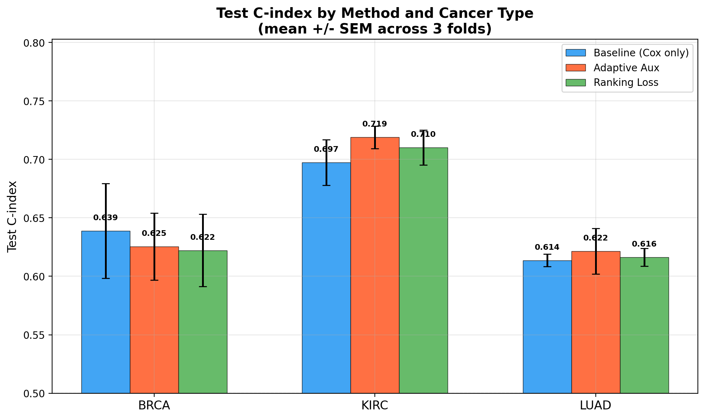

### 2.2 Statistical Significance (Paired t-test vs Baseline)

| Cancer | Method | Delta C-index | t-stat | Significance |
|--------|--------|--------------|--------|-------------|
| BRCA | Adaptive Aux | -0.0135 | -0.894 | p = 0.466 |
| BRCA | Ranking Loss | -0.0167 | -1.385 | p = 0.300 |
| KIRC | Adaptive Aux | +0.0216 | 1.800 | p = 0.214 |
| KIRC | Ranking Loss | +0.0128 | 0.676 | p = 0.569 |
| LUAD | Adaptive Aux | +0.0079 | 0.447 | p = 0.699 |
| LUAD | Ranking Loss | +0.0026 | 0.388 | p = 0.736 |

### 2.3 Best Epoch Timing

| Cancer | Method | Best Epoch (mean +/- std) |
|--------|--------|-------------------------|
| BRCA | Baseline (Cox only) | 16.3 +/- 13.4 |
| BRCA | Adaptive Aux | 6.0 +/- 5.6 |
| BRCA | Ranking Loss | 10.7 +/- 8.7 |
| KIRC | Baseline (Cox only) | 4.7 +/- 6.4 |
| KIRC | Adaptive Aux | 10.7 +/- 12.7 |
| KIRC | Ranking Loss | 8.0 +/- 5.3 |
| LUAD | Baseline (Cox only) | 29.7 +/- 6.4 |
| LUAD | Adaptive Aux | 29.3 +/- 18.0 |
| LUAD | Ranking Loss | 26.0 +/- 6.1 |

---

## 3. Gradient-Level Diagnostics

### 3.1 Gradient Sensitivity Trajectories

The gradient sensitivity measures the mean absolute gradient magnitude per parameter for
each modality encoder. Larger values indicate the encoder is receiving stronger learning
signal from the Cox loss.

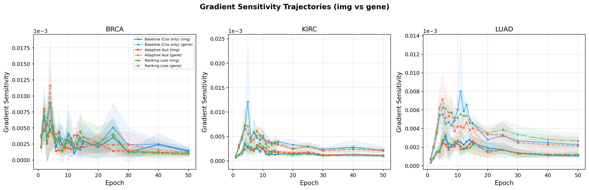

**Key observations:**
- **BRCA / Baseline (Cox only)**: Gene/img ratio = 1.22 ('gene' dominant)
- **BRCA / Adaptive Aux**: Gene/img ratio = 1.54 ('gene' dominant)
- **BRCA / Ranking Loss**: Gene/img ratio = 1.12 ('gene' dominant)
- **KIRC / Baseline (Cox only)**: Gene/img ratio = 2.40 ('gene' dominant)
- **KIRC / Adaptive Aux**: Gene/img ratio = 1.99 ('gene' dominant)
- **KIRC / Ranking Loss**: Gene/img ratio = 2.00 ('gene' dominant)
- **LUAD / Baseline (Cox only)**: Gene/img ratio = 2.21 ('gene' dominant)
- **LUAD / Adaptive Aux**: Gene/img ratio = 2.22 ('gene' dominant)
- **LUAD / Ranking Loss**: Gene/img ratio = 2.39 ('gene' dominant)

### 3.2 Fisher Information Trace

The normalized Fisher trace captures the curvature of the loss landscape with respect to
each encoder's parameters. Higher Fisher trace means the encoder's parameters are in a
region where small changes significantly affect the loss — i.e., the encoder is "learning."

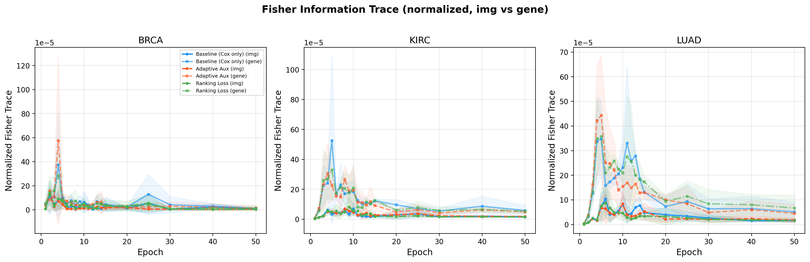

### 3.3 Fisher Ratio (Modality Imbalance)

The Fisher ratio (gene/img) directly measures modality imbalance. A ratio of 1.0 means
balanced information acquisition; deviations indicate one modality dominates learning.

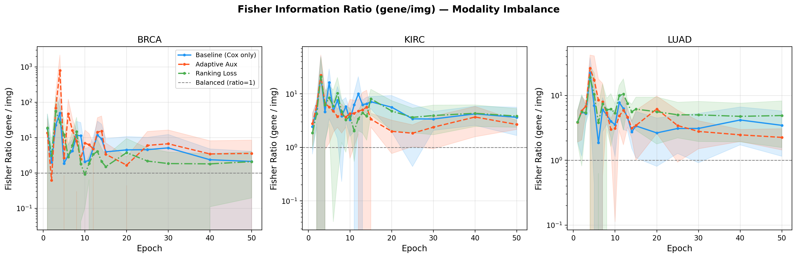

**Early-epoch Fisher ratios (epochs 1--5):**

| Cancer | Baseline | Adaptive Aux | Rank |
|--------|----------|-------------|------|
| BRCA | 18.951 +/- 40.570 | 176.856 +/- 614.767 | 23.540 +/- 45.457 |
| KIRC | 10.063 +/- 14.408 | 8.694 +/- 13.984 | 8.333 +/- 12.886 |
| LUAD | 8.789 +/- 9.832 | 12.046 +/- 14.031 | 8.858 +/- 8.368 |

**Late-epoch Fisher ratios (epochs 40--50):**

| Cancer | Baseline | Adaptive Aux | Rank |
|--------|----------|-------------|------|
| BRCA | 2.239 +/- 1.987 | 3.509 +/- 4.308 | 1.947 +/- 1.615 |
| KIRC | 3.943 +/- 1.665 | 3.192 +/- 1.489 | 4.091 +/- 1.532 |
| LUAD | 3.830 +/- 2.175 | 2.365 +/- 0.624 | 4.842 +/- 2.777 |

### 3.4 Gradient Alignment

The cosine similarity between Cox gradients and ranking-loss gradients indicates whether
the two objectives are complementary (high cosine) or conflicting (low/negative cosine).

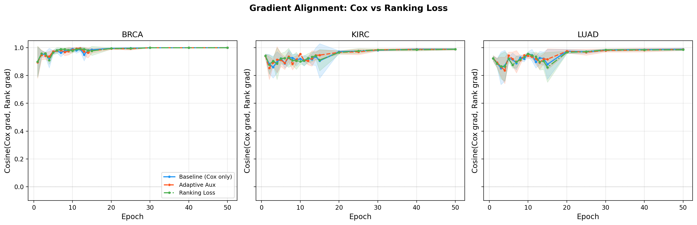
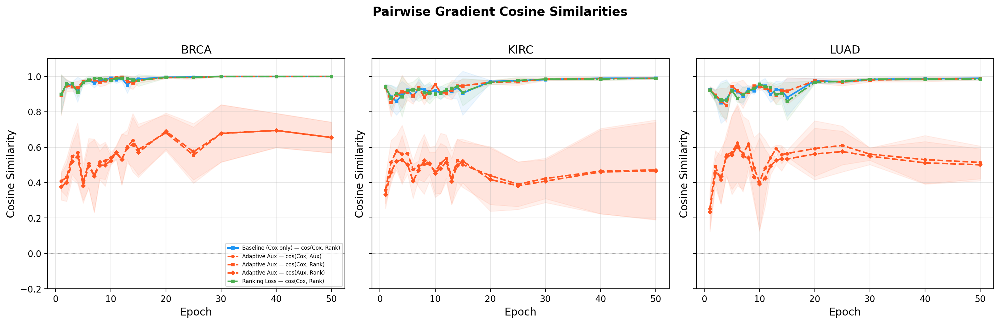

### 3.5 Gradient Variability

Gradient variability (standard deviation of mini-batch gradient norms over the probe set)
indicates training stability. Lower variability suggests more consistent gradient signal.

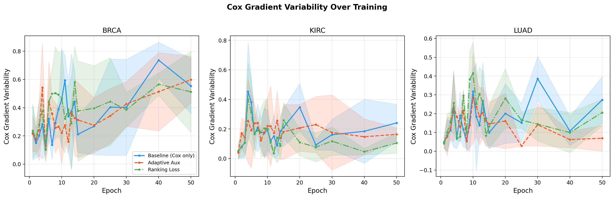

### 3.6 Gradient Norm Ratio

The raw gradient norm ratio complements the Fisher ratio by measuring a simpler statistic
(L2 norm of the full batch gradient rather than per-event Fisher decomposition).

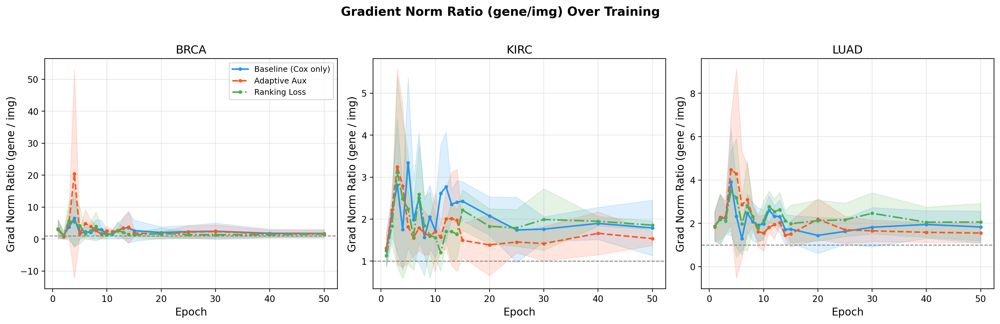

---

## 4. Validation Dynamics

### 4.1 Validation C-index Trajectories

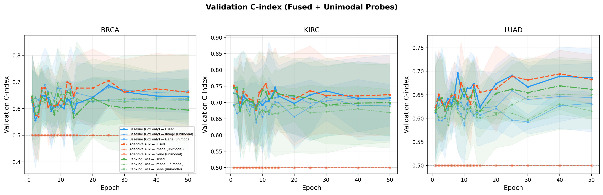
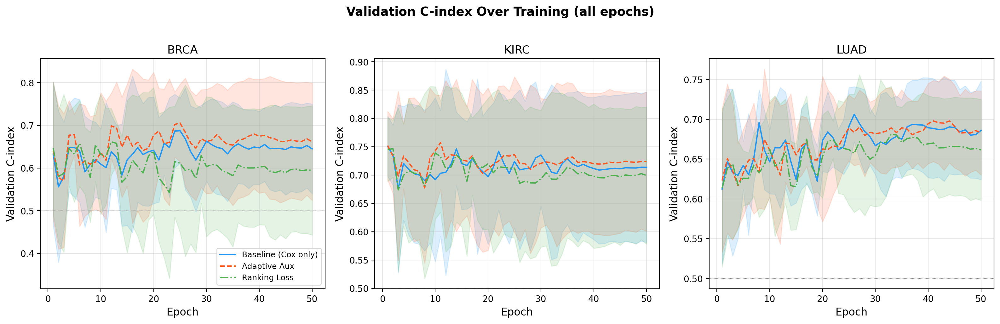

### 4.2 Training and Validation Loss

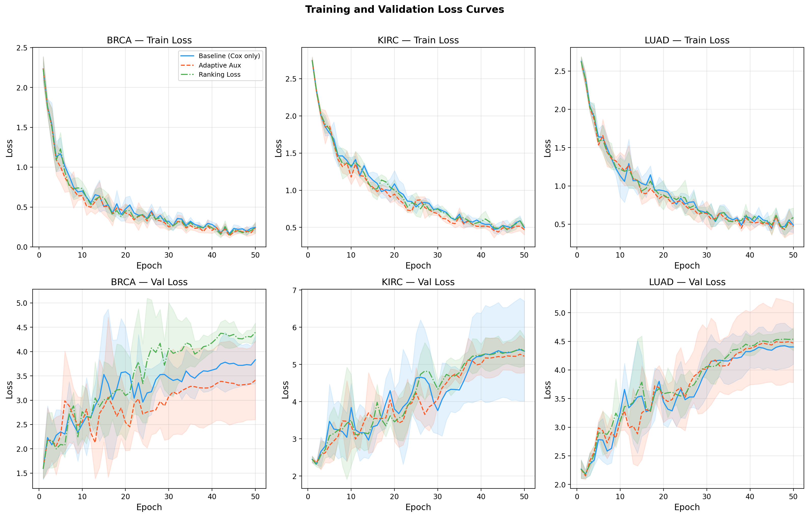

### 4.3 Loss Weight Evolution

For the adaptive_aux method, loss weights can evolve during training:

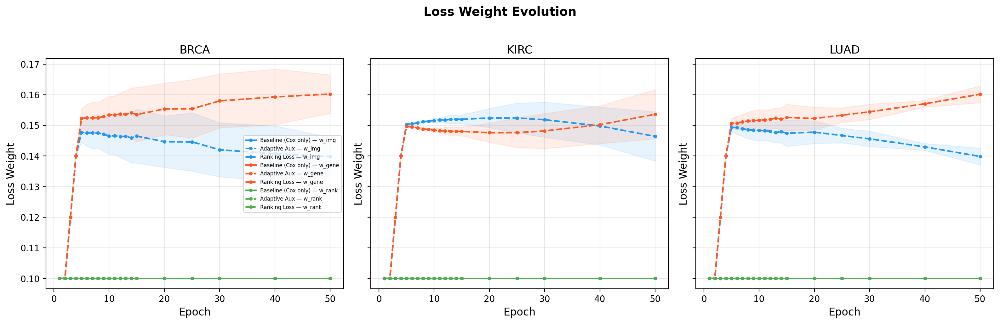

---

## 5. Early Fisher Ratio vs Test Performance

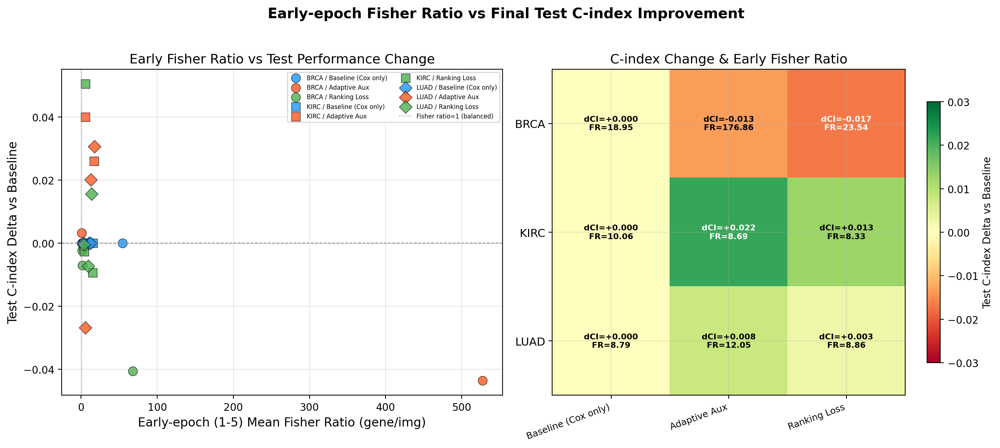

This analysis tests whether early-epoch (epochs 1--5) Fisher ratio predicts final test
performance improvement. The left panel shows individual fold-level scatter; the right
panel shows the mean per cancer/method.

---

## 6. Per-Cancer Analysis

### 6.1 BRCA: Does adaptive_aux improve weaker modality learning?

BRCA is the largest dataset (1,124 patients) and uses UNI 1024-dim image features
(vs 1536-dim UNI2-h for KIRC/LUAD), creating an inherent dimensionality asymmetry.

**Test C-index**: Baseline = 0.6389, Adaptive Aux = 0.6254, Rank = 0.6222

**Fisher ratio analysis**: The early-epoch Fisher ratio for baseline is 18.951, while
adaptive_aux shows 176.856. The adaptive auxiliary heads do NOT reduce the Fisher ratio imbalance; the gene encoder still dominates.
- Adaptive Aux: Unimodal gap (gene - img) at epoch 50 = +0.0000
- Baseline (Cox only): Unimodal gap (gene - img) at epoch 50 = +0.0303
- Ranking Loss: Unimodal gap (gene - img) at epoch 50 = +0.0071

**Interpretation**: Adaptive auxiliary heads slightly hurt performance (-0.0135 C-index) on BRCA, possibly due to optimization interference.

### 6.2 KIRC: Does baseline already have balanced gradients?

KIRC (519 patients) has historically shown more balanced modality contributions.

**Test C-index**: Baseline = 0.6973, Adaptive Aux = 0.7190, Rank = 0.7101

**Fisher ratio**: The baseline early-epoch Fisher ratio is 10.063. This indicates gene-dominant learning even in KIRC, contrary to prior expectations.
- Adaptive Aux vs baseline: +0.0216 (p=0.214)
- Ranking Loss vs baseline: +0.0128 (p=0.569)

**Interpretation**: The best method for KIRC is Adaptive Aux (0.7190). This suggests auxiliary objectives can help even when modalities are somewhat balanced.

### 6.3 LUAD: Does ranking loss affect gradient geometry?

LUAD (522 patients) serves as the test case for whether pairwise ranking loss provides
complementary gradient information to the Cox partial likelihood.

**Test C-index**: Baseline = 0.6137, Adaptive Aux = 0.6216, Rank = 0.6163

**Gradient alignment**: The mean cosine similarity between Cox and rank gradients on LUAD
is 0.9237. This high alignment suggests the ranking loss provides largely redundant gradient information — it pushes in the same direction as Cox.
- Adaptive Aux vs baseline: +0.0079 (p=0.699)
- Ranking Loss vs baseline: +0.0026 (p=0.736)

---

## 7. Cross-Cancer Patterns

### 7.1 Fisher Ratio as Predictor of Intervention Benefit

We tested whether the absolute log Fisher ratio (deviation from balance) at epochs 1-5
predicts the test C-index improvement of interventions over baseline.

**Pearson correlation**: r = -0.3565, p = 0.1465

There is no statistically significant correlation between early Fisher ratio imbalance and intervention benefit. This suggests modality imbalance alone does not predict whether auxiliary objectives will help.

### 7.2 Consistency of Method Rankings

- **BRCA**: Best = Baseline (Cox only) (0.6389)
- **KIRC**: Best = Adaptive Aux (0.7190)
- **LUAD**: Best = Adaptive Aux (0.6216)

**No single method wins on all cancers** — the best intervention is cancer-dependent.

---

## 8. Limitations

1. **Mini-batch risk set bias**: The Fisher trace is computed on a 64-patient probe
   subset with mini-batch risk set approximation. This introduces bias because the Cox
   partial likelihood couples individuals through the risk set (patients at risk at each
   event time). A 64-patient probe may not adequately represent the full risk set structure
   of the training data.

2. **Frozen probes vs trained auxiliary heads**: For baseline and rank methods, unimodal
   C-index is estimated via frozen-feature linear Cox probes fitted post-hoc on training
   data. These have limited capacity and are not equivalent to the trained auxiliary heads
   used in adaptive_aux. Direct comparison of unimodal C-index across methods should be
   interpreted cautiously.

3. **Small fold count**: With only 3 folds, statistical power for paired tests is very
   limited (df=2). P-values should be interpreted as directional evidence, not rigorous
   significance claims.

4. **Diagnostic epoch spacing**: Diagnostics are only computed at 20 out of 50 epochs
   (1-15, 20, 25, 30, 40, 50), missing potential dynamics in epochs 16-19, 21-24, 26-29,
   31-39, 41-49.

5. **No hyperparameter tuning**: All methods use the same learning rate (0.001),
   weight decay (0.0001), and other hyperparameters. The relative performance of methods
   could change with per-method tuning.

6. **Single architecture**: Results are specific to the late-fusion architecture
   (separate encoders + fusion MLP). Early-fusion or attention-based architectures may
   show different gradient dynamics.

---

## 9. Go/No-Go Recommendation for InfoReg-Inspired Intervention

### Evidence Summary

| Criterion | Finding |
|-----------|---------|
| Mean C-index delta (all interventions vs baseline) | +0.0025 |
| Any significant improvement (p < 0.05)? | No |
| Any meaningful improvement (>0.01)? | Yes |
| All interventions positive? | No |

| Criterion | Finding |
|-----------|---------|
| Do interventions reduce Fisher imbalance? | Mixed |
| Is gradient alignment (cox-rank) high? | Yes (>0.94) |

### Recommendation

**CONDITIONAL GO (weak)**: The evidence is mixed but not negative. The auxiliary
objectives do not consistently hurt and show modest improvements on some cancers. Recommend:
1. A targeted investigation on the cancer(s) where improvements were observed
2. Exploring different auxiliary loss weight schedules
3. Considering whether the gradient-level changes (Fisher ratio, alignment) translate
   to real performance gains with better hyperparameter tuning

---

## Appendix: Computational Details

| Cancer | Method | Wall Time (s, mean +/- std) |
|--------|--------|---------------------------|
| BRCA | Baseline (Cox only) | 162.9 +/- 9.7 |
| BRCA | Adaptive Aux | 163.7 +/- 9.5 |
| BRCA | Ranking Loss | 163.4 +/- 9.4 |
| KIRC | Baseline (Cox only) | 113.0 +/- 6.9 |
| KIRC | Adaptive Aux | 113.1 +/- 6.8 |
| KIRC | Ranking Loss | 113.2 +/- 6.8 |
| LUAD | Baseline (Cox only) | 99.4 +/- 3.5 |
| LUAD | Adaptive Aux | 99.3 +/- 3.4 |
| LUAD | Ranking Loss | 99.7 +/- 3.4 |

**Total experiment wall time**: 3383 seconds (0.9 hours)
**Mean per-run wall time**: 125 seconds (2.1 minutes)
**Parameter counts**: Baseline/Rank = 1,451,523; Adaptive Aux = 1,492,741 (+2.8%)

---

*Report generated automatically by `experiments/samo/analyze_info_acquisition.py`*
